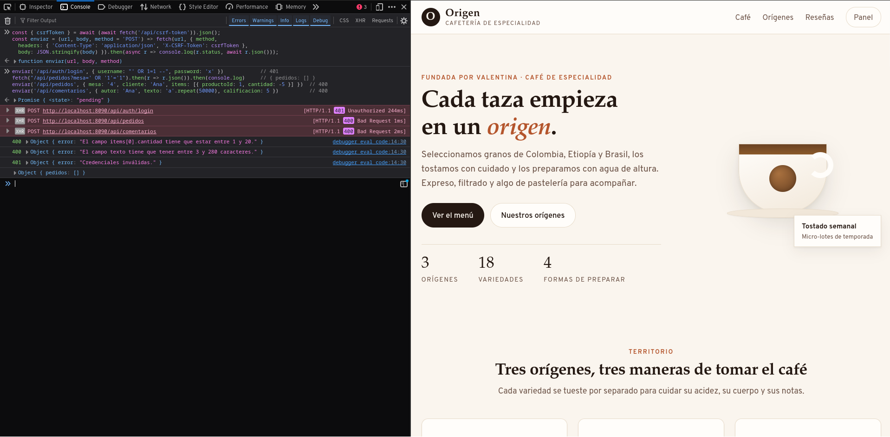
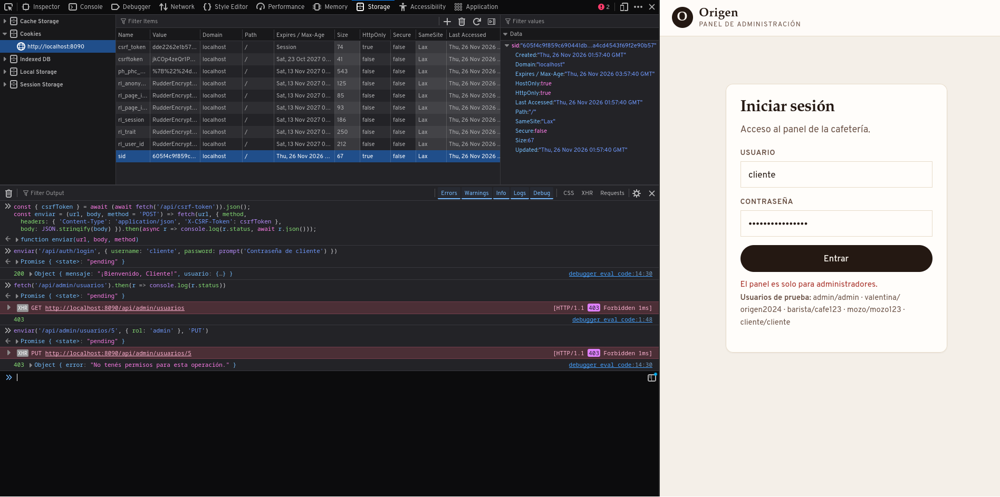
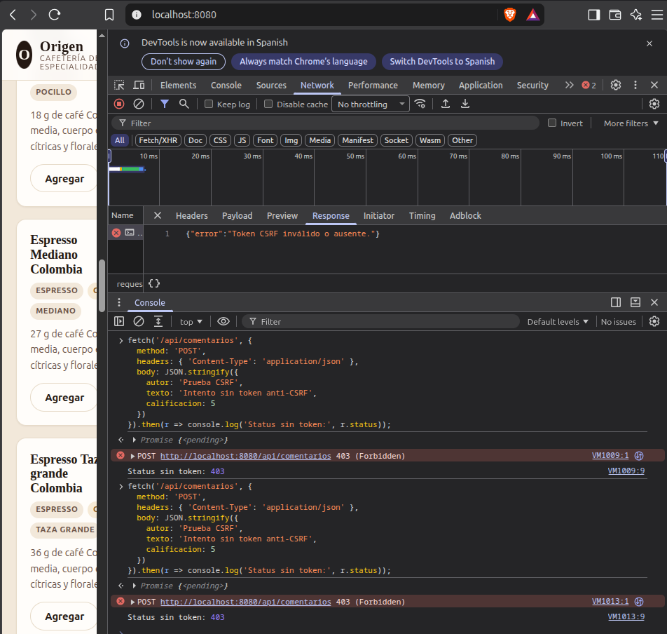

# Informe TP4 - Cafetería Origen
David Cardozo, Alejo Simos, Naim Neman.

## Resultado
| Comando | Antes| Después|
|---|---|---|
| `npm test` | 28/28 | 28/28 |
| `npm run test:seguridad` | 1/29 | 29/29 |
| `npm run check:security` | 3/37 | 37/37 |

## Correcciones
| Vuln. | Corrección | Checklist |
|---|---|---|
| VUL-01 a 04 | Consultas parametrizadas en login, catálogo, mesa y reporte | SQLI-01, 02 |
| VUL-05, 07, 08 | `textContent` en lugar de `innerHTML`; lista blanca de vistas en el panel | XSS-01 |
| VUL-06 | Mensajes de error fijos | XSS-02 |
| VUL-09 | Token anti-CSRF y validación de `Origin` | CSRF-01 a 04 |
| VUL-10, 11 | Validación de pedidos y reseñas en el servidor | VAL-01 a 03 |
| VUL-12 | Archivos: extensión, firma, 2 MB y ruta confinada | VAL-04, 05 |
| VUL-13 | Hash bcrypt (costo 12) | AUTH-01 a 03 |
| VUL-14 | 5 intentos fallidos cada 15 minutos | AUTH-04 |
| VUL-15 a 18 | Cookie `HttpOnly`/`SameSite`/`Secure`, ID aleatorio, expiración y logout en el servidor | AUTH-05 a 11 |
| VUL-19 | Mensaje de login genérico | AUTH-12 |
| VUL-20, 21 | Panel solo para admin; roles de una lista blanca | AUTH-14, 15 |
| VUL-22 | Host en lista blanca y `spawn` sin shell | CMD-01 a 03 |
| VUL-23 | Diagnóstico solo para admin y sin secretos | CFG-03, 04 |
| VUL-24 | Errores 500 con mensaje genérico | VAL-06 |
| VUL-25 | `helmet` con CSP | XSS-03, CFG-01 |
| VUL-26, 27 | Base con contraseña, usuario sin superusuario y credenciales desde el entorno | SQLI-03 a 05, AUTH-13 |
| — | Secretos fuera del código; contenedor con el usuario `node` | CFG-02, 05 |

## Observación manual
**Equipo A:** con un token anti-CSRF válido, la inyección SQL en el login responde 401 y la del filtro por mesa no devuelve pedidos; un pedido con cantidad negativa y una reseña de 50.000 caracteres se rechazan con 400.

**Equipo B:** un usuario `cliente` no entra al panel, y su sesión recibe 403 al listar usuarios y al intentar cambiarse el rol a admin. La cookie `sid` es aleatoria, `HttpOnly`, `SameSite=Lax` y vence a las 2 horas.

**Equipo C:** una petición que cambia estado sin token anti-CSRF se rechaza con 403.

## Riesgos residuales
`GET /api/pedidos`, `PATCH /api/pedidos/:id/estado` y `/api/reportes/*` no piden sesión, porque los tests funcionales de la cátedra los usan sin ella. El panel se oculta a quien no es admin, pero esos datos siguen accesibles por la API.
